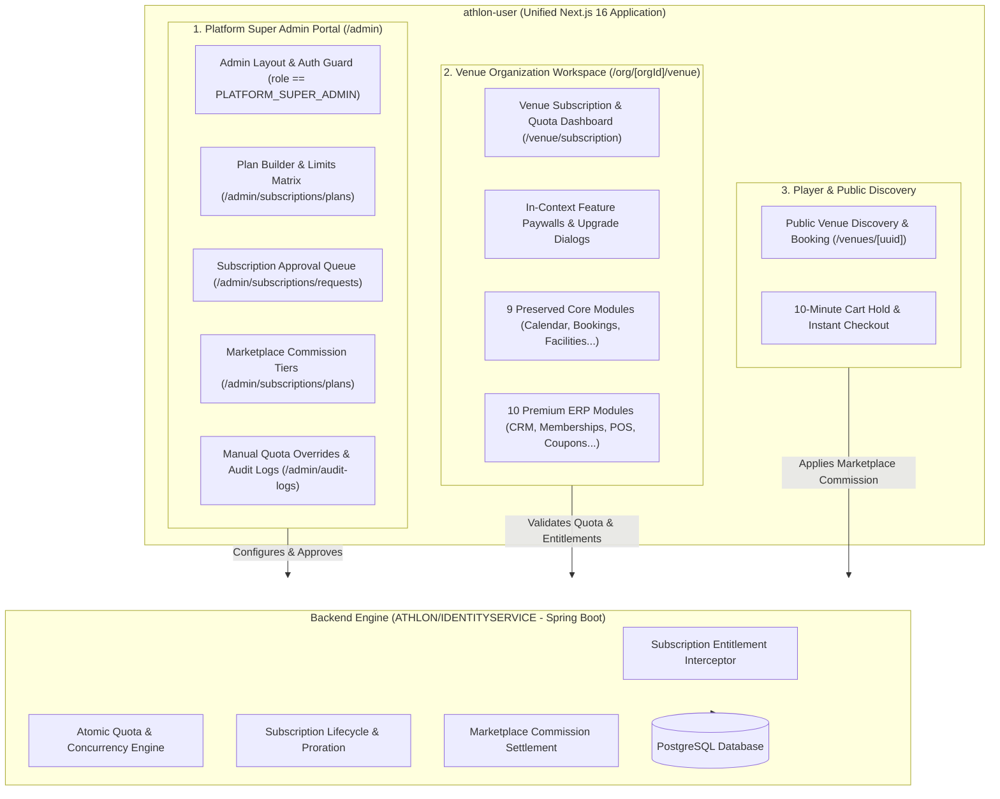

# ATHLON — VENUE SUBSCRIPTION MANAGEMENT & PREMIUM VENUE ERP
## Unified Master Technical Implementation Specification
**Document Version:** 2.0.0 (Unified `athlon-user` Architecture)  
**Target Systems:**  
* **Frontend:** `athlon-user` (Next.js 16.2.10, React 19.2.4) — Single Unified Frontend for Super Admin, Venue Org, and Players  
* **Backend:** `ATHLON/IDENTITYSERVICE` (Spring Boot, Port 5052)  
* **Database:** PostgreSQL (`athlon`)  
**Scope Note:** `athlon-admin` is completely excluded from scope; Super Admin is natively integrated inside `athlon-user` under `/admin/*`.

---

## 1. Executive Summary & Unified Architecture

### 1.1 Objective
Implement a production-ready, centralized **Venue Organization Subscription & Premium ERP System** exclusively within the primary **`athlon-user`** application and backend **`IDENTITYSERVICE`**.

### 1.2 Non-Negotiable Core Rules
1. **Single Frontend Repository**: Everything is implemented in `athlon-user`. Do not touch `athlon-admin`.
2. **Preserve the 9 Core Venue Modules**: Court configuration, 15m Calendar grid, 10-minute cart holds, Dynamic tariffs, Recurring series with conflict checks, Blocks/Maintenance, Reports, 6 Staff roles, and Public venue discovery remain 100% operational.
3. **Dual-Layer Authorization**:
   * **Role Permissions** (`src/lib/api/venuePermissions.ts`): Validates staff operations (Admin, Manager, Front Desk, Supervisor, Finance, Maintenance).
   * **Subscription Entitlements** (`SubscriptionEntitlementService`): Validates organization plan features and atomic resource quotas.
4. **Backend-Enforced Security**: Entitlements and quotas are validated server-side in `IDENTITYSERVICE`.
5. **Zero Data Loss & Safe Grandfathering**: Existing venue organizations are automatically mapped to a legacy-compatible entitlement snapshot with zero service disruption.

---

## 2. Existing Codebase Inventory in `athlon-user`

### 2.1 Super Admin Portal Inside `athlon-user`
Located under `athlon-user/src/app/admin`:
* Guarded by `PLATFORM_SUPER_ADMIN` role check and `useAuthStore.isSuperAdmin()`.
* **Current Navigation Structure**:
  * **Overview**: Platform Dashboard (`/admin`)
  * **Directory**: Users (`/admin/users`), Organizations (`/admin/organizations`), Tournaments (`/admin/tournaments`), Sports Catalog (`/admin/sports`)
  * **Subscriptions & Billing**:
    * Subscription Packages (`/admin/subscriptions/plans`) — *To be extended with versioning, limits, and commission*
    * Approval Requests (`/admin/subscriptions/requests`) — *To be extended with one-click verification & audit*
    * Payments Ledger (`/admin/payments`)
  * **Platform Governance**: SEO (`/admin/seo`), App Modules (`/admin/modules`), Audit Logs (`/admin/audit-logs`), Reports (`/admin/reports`)

### 2.2 Venue Organization Portal Inside `athlon-user`
Located under `athlon-user/src/app/org/[orgId]/venue`:
* Navigation managed by `athlon-user/src/app/org/[orgId]/layout.tsx` for `COURT` or `VENUE_MANAGER` organizations:
  1. **Venue Operations**: Live Calendar (`/venue/calendar`), Bookings & Walk-ins (`/venue/bookings`), Recurring Series (`/venue/recurring`)
  2. **Facility Management**: Facilities & Courts (`/venue/facilities`), Pricing & Slot Rates (`/venue/pricing`), Blocks & Maintenance (`/venue/blocks`)
  3. **Insights & Treasury**: Reports & Revenue (`/venue/reports`), Venue Finances (`/org/[orgId]/finances`)
  4. **Settings & Administration**: Workspace Settings (`/org/[orgId]/settings`), Staff Permissions (`venuePermissions.ts`)

---

## 3. Venue Subscription Packages & Entitlement Matrix

Initial configurable defaults managed directly in `/admin/subscriptions/plans`:

| Plan Attribute | Free | Starter | Professional | Business | Enterprise |
| :--- | :---: | :---: | :---: | :---: | :---: |
| **Monthly Price** | ₹0 | ₹499 | ₹999 | ₹2,499 | Custom |
| **Annual Price (2 Mo Free)** | ₹0 | ₹4,999 | ₹9,999 | ₹24,999 | Custom |
| **Max Venues** | 1 | 1 | 1 | 3 | Custom |
| **Max Facilities (Courts/Pitches)**| 1 | 3 | 10 | 25 | Custom |
| **Max Staff Accounts** | 1 (Owner) | 2 | 5 | 15 | Custom |
| **Marketplace Commission** | 8.0% | 5.0% | 3.0% | 1.5% | Custom |
| **Walk-in / Direct Commission** | 0% | 0% | 0% | 0% | 0% |
| **Core Scheduling Grid (15m)** | ✅ | ✅ | ✅ | ✅ | ✅ |
| **Dynamic Tariff Engine** | ❌ (Base only)| ✅ | ✅ | ✅ | ✅ |
| **Recurring Series** | ❌ | ✅ | ✅ | ✅ | ✅ |
| **Customer CRM** | Basic Profile | History & Notes| Advanced Tags & Segments | Automated Retention | Custom CRM API |
| **Memberships & Prepaid Hours**| ❌ | ❌ | ✅ (Up to 10 plans) | ✅ (Unlimited) | ✅ |
| **Coupons & Loyalty Points** | ❌ | ❌ | ✅ | ✅ | ✅ |
| **QR Code Check-in System** | ❌ | ❌ | ✅ | ✅ | ✅ |
| **POS & Equipment Rentals** | ❌ | ❌ | ✅ | ✅ | ✅ |
| **Advanced Multi-Branch Stock** | ❌ | ❌ | Basic Stock | Multi-Branch + Transfers | ERP Sync |
| **Staff HR & Shifts** | ❌ | Roles only | Roles only | Shifts + Attendance + Payroll | Custom Roles + SSO |
| **Multi-Branch Dashboard** | ❌ | ❌ | ❌ | ✅ | Dedicated Cluster |

---

## 4. Super Admin Enhancements Inside `athlon-user`

All Super Admin capabilities are implemented in `athlon-user/src/app/admin`:

### 4.1 Plan Builder & Entitlement Matrix (`/admin/subscriptions/plans`)
* **Plan Versioning & Immutability**:
  * Edit monthly and annual fees, currency, and display order.
  * Plan Versioning ensures modifying a package creates a new version draft; existing active venue contracts remain pinned to their active `version_id`.
* **Numeric Quotas Matrix**:
  * Configure `MAX_VENUES`, `MAX_FACILITIES`, `MAX_STAFF`, `MAX_MEMBERSHIP_PRODUCTS`, `MAX_PROMOTIONS`.
* **21 Granular Feature Checkboxes**:
  * `VENUE_DYNAMIC_PRICING`, `VENUE_RECURRING_BOOKINGS`, `VENUE_ADVANCED_CRM`, `VENUE_MEMBERSHIPS`, `VENUE_PREPAID_PACKAGES`, `VENUE_COUPONS`, `VENUE_LOYALTY`, `VENUE_QR_CHECKIN`, `VENUE_POS`, `VENUE_EQUIPMENT_RENTAL`, `VENUE_INVENTORY`, `VENUE_ADVANCED_INVENTORY`, `VENUE_EXPENSES`, `VENUE_ADVANCED_ANALYTICS`, `VENUE_STAFF_ATTENDANCE`, `VENUE_PAYROLL`, `VENUE_ASSET_MANAGEMENT`, `VENUE_CLEANING`, `VENUE_MULTI_BRANCH`, `VENUE_API_ACCESS`.
* **Marketplace Commission Slider**:
  * Configures the exact percentage retained by ATHLON on mobile app bookings.

### 4.2 Approval Requests Desk (`/admin/subscriptions/requests`)
* Connects with `platform_subscription_requests` table.
* Displays proof of payment, requested plan, organization contact, and facilities count.
* One-click "Approve & Activate" that instantly creates the active `organization_subscriptions` record and logs the event to `platform_admin_audit_logs`.

### 4.3 Manual Overrides & Add-ons (`/admin/organizations`)
* Super Admin can assign custom quota overrides (e.g. grant a Starter venue 1 extra court) with an obligatory audit reason.

---

## 5. Venue Organization Subscription Dashboard in `athlon-user`

Located at `/org/[orgId]/venue/subscription`:

### 5.1 Real-Time Quota Telemetry Gauges
* **Facility Meter**: `4 / 10 Used` with warning state when quota is near 100%.
* **Staff Accounts Meter**: `3 / 5 Accounts Assigned`.
* **Active Branches**: `1 / 1 Venue`.
* **Active Plan Badge**: Displays `Professional Plan (Annual)` with renewal date countdown.

### 5.2 Reusable In-Context Paywall Dialog (`<FeaturePaywallModal />`)
* When an admin/manager on `Starter` attempts to create a 4th court or navigate to `/venue/memberships`:
  * A modal opens: *"Unlock Memberships & Prepaid Hours with the Professional Plan"*.
  * Displays plan comparison and instant `Upgrade for ₹999/mo` CTA.
  * Preserves current page state so the user resumes work immediately upon upgrade.

---

## 6. Specifications for 10 Premium Venue ERP Modules in `athlon-user`

### Module 1: Customer CRM & Segmentation (`/org/[orgId]/venue/customers`)
* Auto-aggregates customers from all channels (ATHLON App, Front Desk walk-in, Academy, Tournament).
* Displays Lifetime Value (LTV), total booking hours, preferred sports, and attendance regularity.
* Smart segments: `VIP Players`, `Regulars (> 4 bookings/mo)`, `Morning Slot Players`, `Inactive (> 30 days)`.

### Module 2: Memberships & Prepaid Hour Wallets (`/org/[orgId]/venue/memberships`)
* Setup prepaid hour passes (e.g., 20 Hours for ₹6,000).
* Checkout integration: Front Desk or player selects "Pay via Membership Balance".
* Atomic transaction ledger (`venue_customer_membership_ledgers`) preventing duplicate deductions or double refunds.

### Module 3: Dynamic Pricing Integration (`/org/[orgId]/venue/pricing`)
* Extends existing `FacilityPricingRule` engine.
* Sequential tariff calculation: Base Price ➔ Peak/Weekend Rule ➔ Member Tariff ➔ Coupon Reduction ➔ GST.
* Guaranteed minimum payable floor (no negative billing).

### Module 4: Promotions, Coupons & Loyalty Points (`/org/[orgId]/venue/promotions`)
* Configurable promo codes (e.g., `SUMMER20` for 20% off morning slots).
* Constraints: eligible sports/facilities, date validity, cart minimums, and discount caps.

### Module 5: Automated Invoicing & Reconciliation (`/org/[orgId]/venue/finances`)
* GST-ready PDF invoice generation for bookings, memberships, and rentals.
* Daily Front-Desk Cash Drawer Closing report reconciling cash vs. online UPI/Card settlements.

### Module 6: Secure QR Code Check-in System (`/org/[orgId]/venue/checkin`)
* Signs booking tokens with HMAC/server-side validation.
* Front-desk scanner marks status to `CHECKED_IN` with timestamp and staff attribution, eliminating paper check-ins and fraud.

### Module 7: Front-Desk POS & Equipment Rentals (`/org/[orgId]/venue/pos`)
* Kiosk sale of accessories (shuttlecocks, grips, balls, refreshments).
* Hourly racket and shoe rentals with refundable security deposits, attached directly to court booking folios.

### Module 8: Advanced Multi-Branch Inventory (`/org/[orgId]/venue/inventory`)
* Reorder thresholds, stock valuation, and inter-branch stock transfer manifests.

### Module 9: Staff HR, Attendance & Shift Scheduling (`/org/[orgId]/venue/hr`)
* Staff shift rosters (Morning/Evening shifts per court supervisor and receptionist).
* Daily check-in/out logs and salary sheet calculation.

### Module 10: Multi-Venue / Multi-Branch Management (`/org/[orgId]/venue/branches`)
* Dedicated branch switcher in top navigation for `Business` and `Enterprise` accounts.
* Role-scoped data isolation ensuring branch managers access only their assigned facility data.

---

## 7. Marketplace Commission Engine

* **Marketplace Bookings (ATHLON Mobile App)**:
  * Automatically calculates and deducts platform commission based on the venue's active plan version (Free: 8%, Starter: 5%, Pro: 3%, Business: 1.5%).
* **Direct Front-Desk Walk-ins & Phone Bookings**:
  * **0% Commission** (100% of revenue retained by the venue).
* Immutable settlement ledger tracking `booking_gross`, `discount`, `gateway_fee`, `platform_commission`, and `net_venue_payable`.

---

## 8. Database Migration Plan (`IDENTITYSERVICE`)

Additive DDL executed against PostgreSQL:
1. `subscription_plans`: Master plan catalog.
2. `subscription_plan_versions`: Version-controlled plan configurations.
3. `subscription_plan_prices`: Monthly and annual pricing tiers.
4. `subscription_plan_limits`: Quotas for venues, facilities, and staff.
5. `subscription_plan_features`: Feature entitlement mappings.
6. `organization_subscription_addons`: Additional facility and staff purchases.
7. `venue_customer_profiles`: CRM database.
8. `venue_memberships` & `venue_customer_membership_ledgers`: Prepaid hour credits.
9. `venue_promotions`: Coupons and promotional discounts.
10. `venue_pos_products` & `venue_equipment_rentals`: POS and equipment inventory.

---

## 9. Implementation Phasing & Task Checklist

### Phase 1: Database Schema & Backend Entitlement Engine
- [ ] Add migration script for subscription plans, versions, limits, and feature registry.
- [ ] Implement `VenueFeatureCode` enum and `SubscriptionEntitlementService` in `IDENTITYSERVICE`.
- [ ] Implement atomic quota enforcement (`QuotaEnforcementService`) on facility/venue creation.
- [ ] Seed default packages (Free, Starter, Professional, Business, Enterprise).
- [ ] Run automated grandfathering mapping for existing venue organizations.

### Phase 2: Super Admin Enhancements in `athlon-user`
- [ ] Upgrade `/admin/subscriptions/plans` with Plan Editor, Pricing, Quota Matrix, and 21 Feature toggles.
- [ ] Upgrade `/admin/subscriptions/requests` with one-click payment approval and audit logging.
- [ ] Add MRR, ARR, and active subscription analytics to `/admin`.

### Phase 3: Venue Subscription Dashboard in `athlon-user`
- [ ] Create `/org/[orgId]/venue/subscription` with live facility/staff quota gauges.
- [ ] Implement `<FeaturePaywallModal />` component across protected venue pages.
- [ ] Add quota validation guards to the Facility creation modal (`/venue/facilities`).

### Phase 4: Customer CRM & Memberships (Premium ERP)
- [ ] Build CRM module at `/org/[orgId]/venue/customers`.
- [ ] Build Memberships and Prepaid Hour Wallets at `/org/[orgId]/venue/memberships`.
- [ ] Connect booking checkout with membership balance deductions.

### Phase 5: Promotions, POS & Equipment Rentals (Premium ERP)
- [ ] Build Promotions and Coupon engine at `/org/[orgId]/venue/promotions`.
- [ ] Build POS product catalog and equipment rental desk at `/org/[orgId]/venue/pos`.
- [ ] Link equipment rentals to court booking folios.

### Phase 6: Multi-Branch & Staff HR (Business ERP)
- [ ] Build Multi-Venue branch switcher and consolidated reports.
- [ ] Build Staff Shift Scheduling and Attendance at `/org/[orgId]/venue/hr`.

---

## 10. Regression & Verification Test Plan

1. **Core Operations**: Verify existing facility creation, 15m calendar grid, 10-minute cart holds, and offline walk-ins execute without error.
2. **Quota Enforcement**: Verify creating a 4th facility on the Starter plan (limit: 3) returns a 403 error and opens the upgrade dialog.
3. **Concurrency Test**: Send 2 simultaneous facility creation requests at quota cap - 1; verify exactly 1 succeeds.
4. **Prepaid Hours**: Verify debiting 1 hour from a 20-hour pass leaves 19 hours and records an immutable ledger entry.
5. **Grandfathering**: Verify existing pre-migration venues retain full access to their existing facilities and pro features.
6. **Commission Logic**: Verify ₹1,000 app booking incurs 5% commission on Starter, while ₹1,000 walk-in incurs 0% commission.
